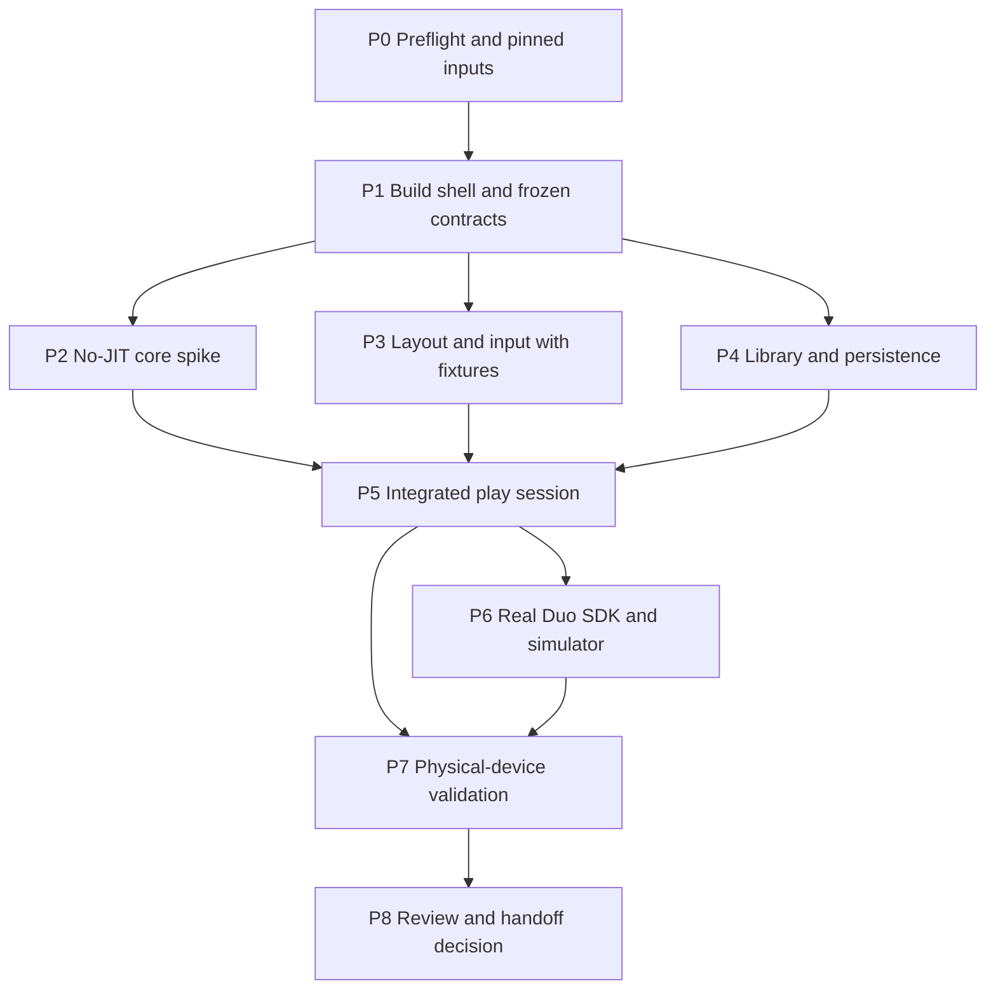

# Proof-of-concept execution plan

## 1. Objective and decision

Build a small native iOS app that runs Nintendo DS software through an existing emulator core, displays both DS screens on the folding inner display, and preserves the session across layout and lifecycle changes. Determine whether no-JIT emulation, input comfort, and sustained performance justify a full product.

The execution agent must produce runnable source, reproducible build instructions, a pinned dependency manifest, test evidence, and a final decision. A convincing animation or fake game screen does not prove emulation. A simulator pass does not prove device performance or ergonomics.

Use [TECHNICAL_DESIGN.md](TECHNICAL_DESIGN.md) for contracts and [VALIDATION.md](VALIDATION.md) for acceptance criteria. [RESEARCH.md](RESEARCH.md) distinguishes documentary findings from locally verified facts.

## 2. Scope

### Required vertical slice

- Import a user-selected `.nds` file through the system file picker into app-managed storage; show a minimal library with launch, resume, and delete controls.
- Run ordinary DS software using a bundled, pinned core, with JIT disabled and native-resolution software rendering as the baseline.
- Show both 256 × 192 DS screens, preserve their aspect ratios, support screen swapping, and map touch to the logical lower DS screen regardless of its visual position.
- Provide virtual buttons, physical controller input, direct touch/Pencil input where supported, user-enabled microphone input, and an explicit emulated lid control.
- Adapt to a horizontal fold, flat display, ordinary iPhone viewport, and resized windows. Offer a manual layout override and a compact outer-display layout.
- Pause/resume safely on interruptions, release held inputs, persist cartridge saves, and support versioned manual save states where the chosen core supports serialization.
- Collect timing, audio, and thermal evidence without recording user content or including game assets in the repository.

### Explicitly deferred

DSi/3DS, multiplayer/netplay, downloadable game catalogs, cloud sync, achievements, rewind, enhanced internal resolution, shaders, custom physical controllers, simultaneous inner/outer gameplay, App Store submission, public beta distribution, and monetization. Do not add a camera session to obtain access to the outer display. Do not develop a new DS emulation core.

## 3. Baseline decisions

| Decision | Default | Change condition |
| --- | --- | --- |
| Emulation | Current stable, source-pinned `JesseTG/melonds-ds`, minimal native libretro host | A reproduced integration, build, or performance blocker justifies evaluating upstream melonDS directly |
| Execution | Interpreter/no JIT, software rendering | No exception within this POC; failure triggers a scope/performance decision |
| App | SwiftUI/UIKit shell, C/C++ bridge, Metal presentation | Prefer the smallest working implementation compatible with the pinned core |
| Display | Two logical DS screens within one inner-display scene | Outer screen used only as the system's active app display after transition |
| Session | One emulation session owned independently of view recreation | Additional scenes show an explanation or route to the existing session |
| Minimum OS | Set after core/toolchain preflight; support a current physical test iPhone if feasible | Document any older-device requirement that obstructs the POC |
| Fold integration | Verified public SDK APIs isolated behind an adapter | If unavailable, synthetic layout tests continue, real fold acceptance remains blocked |
| Licensing | Treat GPL obligations as a design constraint, retain notices and corresponding-source information | A required proprietary distribution model needs a separately resolved licensing decision |

These are proposed implementation decisions, not claims that an app has already built or passed tests.

## 4. Prerequisites and local constraints

At planning time the selected Xcode is 27.0 with iOS 27.0 SDKs. The researched Duo APIs are associated with the newer beta toolchain, which has not been verified locally. Simulator runtime inventory was blocked by execution-environment access; do not infer that runtimes are absent. CMake and Ninja were not found on PATH. See the complete [preflight record](RESEARCH.md#local-preflight).

Before dependent work, establish:

1. Toolchain and runtime availability; exact SDK availability and signatures from installed headers or official documentation.
2. A physical baseline iPhone, and eventually a Duo, with OS versions and permitted deployment access.
3. Signing availability for local device testing. Never collect credentials in a document or change the global developer directory unnecessarily; use a per-command `DEVELOPER_DIR` when appropriate.
4. A lawful validation corpus with provenance, checksums, and supported use; a redistributable homebrew path for unattended work.
5. The selected core commit, license files, dependency inventory, build options, and simulator/device architecture support.

At P0, make lid-input capability a hard core-selection check and identify a lawful serialization-capable fixture for V20. Homebrew is enough to start; the chosen core documents unsupported homebrew save states, so that corpus alone cannot establish a supported save-state round trip. Use an appropriately licensed title supplied by the user or explicitly distributed by its rights holder, with provenance recorded; do not source unauthorized copies. If none is available, mark V20 blocked and continue other packages. The full-scope POC cannot earn GO until that evidence exists or a clearly recorded scope revision removes the feature.

Do not wait for Duo hardware to implement portable core, input, persistence, and synthetic layout work. Keep unavailable prerequisites visible as blocked gates. Installation, device pairing, credentials, or sandbox escalation must follow the executing environment's permission rules. No external publishing or messages are authorized by this handoff.

## 5. Agent topology and coordination

Use a root orchestrator plus at most three workers concurrently, subject to available slots and applicable project instructions. Read the local orchestrate skill before spawning. Default budget: **two Sol implementation workers plus one Luna verification runner per wave; one fresh Sol high-reasoning review at integration**. Use a stronger reviewer if concrete concurrency, memory-safety, or security issues warrant it. A runner checks named commands; it must not silently redesign code.

The root owns the project/build files, module contracts, dependency changes, integration commits, gate decisions, and evidence summary. Workers own disjoint paths. Do not have multiple agents edit an Xcode project, shared bridge header, or test manifest concurrently. Root may explicitly transfer ownership between waves after an agent finishes. Inspect repository status and preserve existing work; do not assume the empty planning workspace remains empty. If no Git repository exists, establish a local repository at P0/P1, add appropriate ignore rules before importing assets/build output, and record a source revision for each gate. Do not create a remote or publish. If Git initialization is blocked by the environment, use a hashed source archive with a manifest and document clean extraction as the reproducibility equivalent; never claim a clean checkout was tested when only the working directory was used.

Every assignment must contain: objective, exact inputs, owned files, dependencies, acceptance test, stop rule, and return format. Workers return changed paths, commands and outcomes, evidence paths, remaining failures, and proposed next action. A claimed pass without inspectable evidence is unverified.

Create `docs/poc/WORK_LOG.md` when execution begins. Record package status (`not started`, `active`, `blocked`, `passed`, `failed`), owner, source revision, dependency, evidence, and next action. Create `docs/poc/DECISIONS.md` for outcome-changing departures from this plan. Do not rewrite this plan to conceal an unmet gate.

## 6. Dependency graph and work packages

P7 can collect baseline-iPhone evidence before P6 or Duo access, but full target-device acceptance depends on both. P8 may produce a conditional handoff when physical evidence is blocked; it must not mark the full POC passed.

| Package | Owner and exclusive paths | Work and required output | Exit criterion |
| --- | --- | --- | --- |
| P0: preflight | Root; dependency manifest, `WORK_LOG.md`, `DECISIONS.md`, evidence manifest | Inspect environment; verify official APIs; choose and pin source; record licenses; inventory devices, signing, and lawful fixtures | G0 status recorded per validation plan; missing prerequisites identified by dependent package |
| P1: build and contracts | Root; Xcode project/workspace, build configs, `App/`, scripts, shared protocol/header declarations | Create a reproducible app target and test target; freeze core/video/input/persistence/display contracts; create fake-core and geometry fixtures | Blank app and host tests build in an available environment; commands and limitations recorded |
| P2: emulation spike | Sol A; `Emulator/CoreBridge/`, `Emulator/Runtime/`, `Emulator/Video/`, `Emulator/Audio/`, matching tests | Integrate pinned core, static linking, no-JIT options, software video callback, audio scheduling, instrumentation; run approved fixtures | Real DS execution demonstrated; no-JIT build evidence and G1 physical-baseline results, or explicit device blocker |
| P3: adaptive play UI | Sol B; `Platform/DisplayEnvironment/`, `Features/PlaySession/`, `Emulator/Input/`, matching tests | Implement synthetic geometry adapter first; two-screen layout, reserved-space handling, controls, screen swap, touch transform, manual override | Deterministic layout/input tests and fixture captures; no claim of actual hinge integration yet |
| P4: library and saves | Third worker, Sol if implementation is needed; `Features/Library/`, `Emulator/Persistence/`, matching tests | Files import, app-owned copy, identity, battery saves, versioned states, atomic writes, load errors, deletion semantics | Import and save round trips; corruption/version mismatch handled without damaging valid battery saves |
| P5: integrate | Root owns composition/build files; owners fix their modules sequentially as needed | Replace fixtures with real callbacks; wire controller/mic, layout, persistence, lifecycle; ensure one session and release inputs on transitions | End-to-end import → play → save → interrupt → resume; functional validation evidence |
| P6: Duo SDK | Sol B after P3 completion; display adapter and play layout; root updates build settings | Compile real documented APIs with appropriate SDK; test actual Duo simulator transitions, fold regions, outer viewport, multitasking | G2 actual-simulator evidence; synthetic-only result remains partial |
| P7: device measurements | Root or named device operator; `artifacts/poc/<run-id>/`; no shared code edits | Baseline iPhone and physical Duo sessions, sustained performance, input and ergonomic trial, save/lifecycle stress | G3 matrix complete or accurately blocked; failures routed back to owning module |
| P8: independent review | Fresh read-only Sol reviewer; root integrates fixes and writes final report | Review actual diff and evidence against invariants; run meaningful verification; consolidate license/build/source handoff | G4 report includes decision, reproducibility, known failures, and remaining hardware work |

If only two worker slots are available, schedule P4 after P2 or P3 frees one. A Luna runner may use the third slot when P4 is not active. No worker is permitted to change another worker's contract without root coordination.

## 7. Wave sequencing and stop rules

### Wave 0 — establish what can be executed

Complete P0 and P1. Timebox initial core/platform selection to one focused engineering day. Start with the documented iOS core; do not spend days comparing every emulator. If source cannot be built reproducibly, record the exact blocker, attempt one focused repair, then evaluate direct upstream integration with an explicit decision entry.

Freeze a minimal set of contracts before parallel work: session lifecycle, per-frame screen description, copied-frame lifetime, input representation, audio format, cartridge-save/state operations, and display environment. Root gives workers the same contract revision.

### Wave 1 — independent implementation

Run P2/P3/P4 with nonoverlapping ownership. Core performance uncertainty is the highest-risk branch; prioritize evidence there. Workers may develop against fixtures, but must label them. Review useful increments daily rather than letting three long-lived branches diverge.

### Wave 2 — integration and target behavior

Integrate P5, then P6 with the verified SDK. If beta SDK access is unavailable, finish ordinary-iPhone and synthetic tests and leave P6 blocked. Do not imitate undocumented selectors or use private APIs. Persist the emulation session outside the view tree so folding or resizing does not reboot the game.

### Wave 3 — device decision and review

Run P7 and P8. A simulator-only demonstration can earn a conditional continuation decision, not proof of Duo feasibility. A repeatable no-JIT performance failure is a real finding: profile the dominant cost, make one bounded optimization, rerun only affected measurements, and decide whether scope should narrow. Do not add JIT as an escape hatch.

For any worker blocked for approximately 30 minutes on missing access or an unresolved shared contract, report immediately and switch to independent assigned work if available. A timebox does not turn a failed requirement into a pass.

## 8. Commands and reproducibility contract

At P1 the root creates a single documented build entry point and test entry point (for example `scripts/build-poc.sh` and `scripts/test-poc.sh`). **These scripts do not exist yet.** They must expose scheme/configuration/destination, use a repository-local or explicitly documented output directory, and preserve command exit codes. Do not hardcode a simulator UUID or team identifier into source.

The final build instructions must include:

- Toolchain selection and exact tested versions; device and simulator architectures.
- Dependency retrieval from pinned source, hashes/revisions, build flags, and license notices.
- A clean-checkout simulator build/test command using an actually discovered destination.
- A separate local-device signing/deployment procedure without embedded credentials.
- How to supply legal test assets, select the benchmark profile, collect evidence, and interpret a blocked hardware check.

Build failures and simulator-service access failures are different results. Record both accurately; request execution permissions only where the environment requires them.

## 9. Completion and decision rules

Gate details and numeric targets live only in [VALIDATION.md](VALIDATION.md), which is authoritative for measurements. The root must not relax them silently to match observations.

- **GO:** Required implemented behavior and G0–G4 evidence satisfy the acceptance plan, including real Duo testing. This authorizes recommending a full product, not publishing one.
- **CONDITIONAL GO:** G0/G1 baseline evidence passes, but target SDK/simulator, physical-Duo, or lawful target-validation fixture prerequisites remain unresolved. Enumerate exactly what must happen next. Do not label the POC complete.
- **NO-GO:** A reproduced blocker defeats a required premise within the agreed scope, such as unacceptable sustained no-JIT performance or unusable controls. Preserve the prototype and evidence with the reason.

If baseline evidence is unavailable and no decisive failure exists, report **assessment pending** with blocked/not-run gates. Missing access is not a technical failure. Unresolved rights information blocks the relevant work; confirmed incompatibility can justify a no-go.

Final deliverables: runnable app source; pinned dependency and license inventory; build/run guide; lawful fixture manifest; test and measurement artifacts; independent review findings and resolutions; final gate table and decision. Screenshots must identify whether they show fixtures, real emulation, simulator, or hardware.

## 10. Planning estimate and scope control

Initial estimate: 2–4 weeks of experienced iOS/C++ engineering for a narrow POC after access to required tools and fixtures. Parallel agents can reduce independent implementation time, but cannot replace physical-device trials or human ergonomic feedback. Device availability, signing, or beta SDK delays are outside that estimate. Re-estimate after G1; do not promise a launch-date release from this plan.

Treat product polish, broad game compatibility, and distribution readiness as a later project. The POC succeeds by producing a trustworthy decision, including an honest no-go if warranted.
